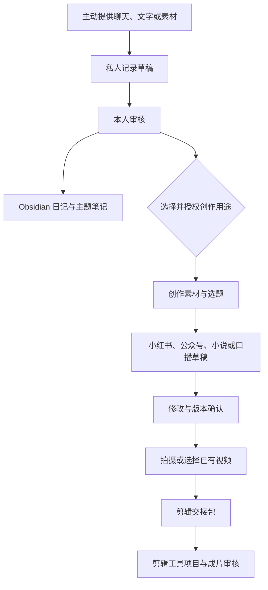

# Healing Journal：产品思路与开发计划

状态：产品方向草案，供持续维护与讨论。
更新日期：2026-11-19。

## 1. 产品定位

**从记录自己，到表达自己。**

Healing Journal 将用户主动提供的生活记录和聊天，整理为保留感受、思考及认知变化的日记，再把用户选中并授权的部分转成文章与视频创作素材。

它是一个产品：记录能力是底座，创作工作台是扩展界面。工作流描述内容如何流转，工作台让用户查看、修改并控制这条流程，Skills 和程序提供执行能力。它不是心理诊断或治疗产品，也不是默认公开私人生活的内容生产器。

## 2. 一个产品，两个空间

| 空间 | 内容 | 默认边界 |
| --- | --- | --- |
| 私人记录 | 授权聊天、日记、情绪、认知变化、来源证据 | 私人，不自动进入创作 |
| 创作工作 | 选题、平台稿件、口播稿、拍摄素材、剪辑项目 | 仅使用用户选中并授权的素材 |

桥接动作是“把这段转成创作素材”。创作保留对原素材及具体版本的引用，但公开导出不携带私人源文件路径、原始聊天或不必要的身份信息。

创作模块可以接受独立想法和视频素材，但在本产品中仍共享记录、风格及选题体系，不另起一套互不相通的数据系统。

## 3. 核心流程

日记发布、创作使用、向外部服务传输和平台公开发布是不同的授权。批准其中一项不自动批准其他项目。

## 4. 当前已实现的能力

- Python 3.11+ 标准库 CLI：解析 ChatGPT 导出 JSON，保留消息分支、时间与来源，按消息日期筛选和去重。
- 原始文件本地归档，Markdown 草稿先行；发布时核对内容摘要，拒绝覆盖已有笔记。
- 可配置 Obsidian Vault；初始化独立数据目录、检查配置及 Vault 是否存在。
- 日记、主题笔记及双向链接；语义整理由 Agent 按 Skill 执行，不由 Python 自动完成。
- 日记、小红书、公众号、小说素材 Skills，通用写作模板和私人风格参考目录。
- 通用核心规则、Codex/Claude Code 入口，以及千问/WorkBuddy 可复制指令。
- 可构建的插件预览包、仓库市场清单、合成测试数据与自动化测试。

### 当前实现的实际边界

- 仓库没有自动获取普通 ChatGPT 聊天历史的能力；用户需主动提供文件或内容。
- “生成全套”由 Agent 读取规则并执行，不是无人值守的一键生成 CLI。
- 插件为预览版；真实客户端安装、官方目录上架和其他 Agent 的兼容性仍需验证。
- 目前没有工作台界面、口播 Skill、视频素材管理、MCP 服务或剪辑工具连接。
- 定时运行规则已描述在核心规则中，去重状态依赖执行 Agent 遵守；仓库没有独立可靠的后台调度器。个别使用者在客户端创建的任务不随仓库安装。
- 发布尚未实现跨文件事务回滚；并发处理、崩溃恢复和发布撤销仍需完善。
- 本地文件保存不等于离线 AI 推理；传给云端 Agent 或剪辑服务的内容涉及对应服务的数据处理。

## 5. 工作台 MVP

先做三个页面，先完成单个用户、单个选题从素材到确认稿的闭环，不加入多人协作或自动公开发布。

### 素材收件箱

主动导入文字、聊天和随手拍文件；显示来源、日期、授权状态与已处理状态。附件先作为文件引用管理，不能仅凭文件名推断画面内容。大文件不进入 Git。

### 选题看板

按“灵感、待写、待改、待拍、待剪、待审核、已完成”组织选题。已完成不等同于已公开发布，发布状态单独记录。支持一个素材关联多个选题，但不会因关联自动扩大授权。

### 选题详情

集中显示中心问题、目标读者、素材引用、用途授权、平台草稿、版本、待确认项、拍摄清单与剪辑交接信息。记录风格偏好及其确认状态，生成新版本而不是覆盖用户改稿。

## 6. 口播与剪辑扩展

新增口播 Skill：从一个选题生成口播正文、开头候选、预计时长、分段和画面建议。时长为估算，实拍或音频确定后再校正；不编造已拍画面、用户经历和引语。

支持两种入口：先写稿再补拍，或先选随手拍再组织旁白。形成交接包：确认稿、授权素材清单、镜头顺序、字幕文字、节奏说明和缺失素材。没有真实音频就不声称具备准确字幕时间轴。

OpenFilm 的具体项目、版本和接口尚未确认。先定义独立于供应商的交接格式，再验证是否能创建可编辑项目；不能把计划中的连接表述为现成功能。其他剪辑 Skill 同样通过适配层调用，不绑定唯一供应商。

## 7. 数据与权限设计（拟议）

每项素材有稳定 ID、来源引用、内容摘要、事件日期与导入日期、版本和授权记录。拟议对象包括 Source、JournalDraft、Insight、CreativeAsset、Topic、DraftVersion、Approval、VideoAsset、EditPackage。

授权记录至少包含：对象与版本、用途、操作范围、批准时间、允许的外部目标。对稿件的批准绑定具体版本；改稿后重新确认。可撤销未来使用授权，但已经导出或公开的副本不能承诺自动收回。

原始来源、Agent 解释和虚构内容分层存储。UI 默认显示创作所需的最少片段，避免把整个日记带入无关生成请求。将来外部调用前显示将发送哪些内容。

## 8. 技术结构

- 核心程序独立于 AI 平台，处理导入、去重、版本、授权校验和导出。
- Markdown 保持可读可迁移；结构化状态可逐步引入本地 SQLite，具体迁移需单独设计与测试。
- 核心规范统一维护，平台入口和分发包通过构建脚本生成，减少副本漂移。
- 本地 MCP 服务作为可选适配层，提供结构化调用，不绕过审核与文件权限。
- 工作台作为核心程序之上的界面；初期以本机单用户为目标，技术框架在界面实施前确定。
- 调度器与工作流分开：定时任务调用相同入口，内容哈希去重、锁和失败重试由程序保障，不仅依靠提示词。

## 9. 分阶段实施与验收

| 阶段 | 工作 | 验收条件 |
| --- | --- | --- |
| A：稳定底座 | 插件安装实测、包与源文件一致性检查、配置体验、错误提示和恢复 | 干净环境完成安装、示例导入、审核发布；更新不影响私人数据 |
| B：记录到创作的桥 | 素材 ID、用途授权、选题、版本与状态、口播 Skill | 选中一段记录后生成指定稿件；未授权材料不进入创作；改稿保留旧版本 |
| C：本地工作台 MVP | 收件箱、选题看板、详情与审核 | 无需修改 JSON 即可完成导入、授权、生成、改稿和导出 |
| D：视频交接 | 随手拍引用、拍摄清单、供应商无关交接包、验证剪辑适配 | 使用合成或授权素材完成一个可审查的剪辑交接，缺失素材明确标出 |
| E：可靠自动化与分发 | 调度入口、锁、失败恢复、MCP、跨客户端测试 | 同素材不重复生成；失败可重试；多客户端不并发破坏状态；公布实测兼容表 |

按上述顺序推进，每阶段产物可独立使用。平台自动公开发布、多用户云端托管和商业计费不属于第一版范围。

## 10. 产品验证

优先观察用户能否顺利生成第一份有用草稿、是否愿意再次使用、需要修改哪些内容、是否保留稿件，以及是否清楚知道哪些素材会被使用。使用自愿反馈，默认不收集私人正文或后台遥测。

展示产品时使用合成示例：原始片段 → 感受与思考日记 → 授权的选题 → 稿件 → 剪辑交接。不能用用户真实私人内容作为公开演示默认素材，也不承诺疗效、爆款或涨粉。

## 11. 下一批任务

1. 验证插件客户端安装及独立数据目录路径，并补充实际兼容表。
2. 对构建产物做一致性与隐私白名单检查，消除失效的包内文档引用。
3. 编写素材、选题、版本与用途授权的最小结构及校验测试。
4. 增加口播 Skill 和合成案例，验证内容证据与虚构边界。
5. 以这套结构做工作台交互草图，再实施三个 MVP 页面。
6. 确认 OpenFilm 项目链接后调研剪辑交接接口。

## 12. 待确认决策

- 首批用户更关注个人记录还是持续创作，工作台首页的默认入口是什么？
- 口播主要是本人出镜、画面配旁白，还是两者均需支持？
- 外部 AI 与视频服务的提供方式、费用和数据边界如何说明？
- OpenFilm 的具体产品与接口是什么？
- 工作台采用何种本地安装与升级方式，调度归谁负责？

这些是后续产品决策，不影响继续维护现有日记工具。
